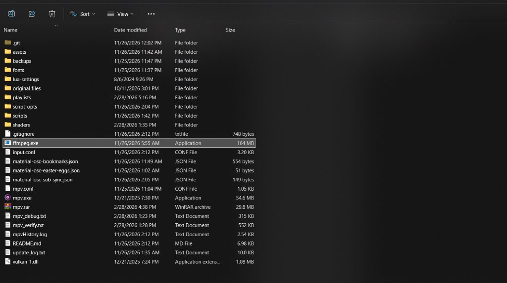

# MPV: Material OSC Revolution Edition (v3.0)

> **Release Notice (v3.0):** Evolved from the **UOSC × Modern Z** build into a custom-engineered **Material OSC** frontend — preserving all shaders, `SimpleHistory` auto-resume, `Thumbfast` previews, and hotkeys while fixing all major UI/input bugs in v3.0. See [update_log.txt](update_log.txt) for earlier v1→v2 history.

A heavily customized, GPU-accelerated setup for the [mpv media player](https://mpv.io/) on Windows (`vo=gpu`, `gpu-api=vulkan`, `hwdec=nvdec`).

---

## 📸 Screenshots

### Main Material UI & Dynamic Finish Clock

### Thumbfast Thumbnail Preview

### Gear Settings Menu

### Subtitle Delay & Sync Suite (`Type` / Smooth Slider / `Voice Heard` & `Subtitle Seen`)

### Dedicated History Button (`SimpleHistory` Overlay)

### Anime4K Upscaling (`Mode C+A Fast`)

---

## ✨ What's New in v3.0

### 🖱️ Smart Mouse & Edge-Seek Controls
- **Double-Click Edge Seeking (`-5s` / `+5s`):** Left double-click the left or right **15%** of the screen to seek `-5s` / `+5s` (`seeking_zone_percentage=15`, `seek_step_seconds=5`).
- **Context-Locked Safety:** Edge seeking and center double-click fullscreen are automatically locked whenever any menu, Playlist, Settings, Subtitles, or `SimpleHistory` panel is open.
- **Instant Header Buttons & Switch-Bounce Protection:** Back (`<-`), Close (`X`), and Subtitle Settings buttons respond immediately on the first click, with a 60 ms `mbtn_left` debounce guard to filter worn-switch double/triple bounces without blocking intentional double-clicks.
- **Center Double-Click Fullscreen & Right-Click Pause:** Double-clicking the center 70% toggles fullscreen; `MBTN_RIGHT` toggles Play/Pause; single left-click play/pause remains disabled.

### 🛠️ Stability & YouTube Fixes
- **Clean `thumbfast.conf`:** Replaced corrupted HTML config with a clean 30-line `thumbfast.conf` eliminating startup config warnings.
- **Single-Load Script Architecture:** Keep `mpv.exe` outside `%AppData%\mpv` so scripts and keybindings never load twice.
- **YouTube Paste (`Ctrl+V` / `SmartCopyPaste`):** Configured `idle=yes`, `running_paste_behavior=force`, `no-playlist=`, Node.js `js-runtimes`, and progressive stream format fallback in [mpv.conf](mpv.conf).

---

## ✨ Core Material OSC Features (v2.0+)

### 🎨 Custom Material OSC Interface
- **Top-Left Frosted Media Title Pill:** Displays the current video title cleanly at the top-left of the frame and fades smoothly with the controller.
- **Unobstructed Seekbar & Windowed Mini-Bar:** Clean `#008cfb` accent seekbar with `Thumbfast` thumbnail previews; mini bottom progress bar appears only when windowed and hides in fullscreen.
- **Dynamic Finish Clock (`Ends X:XX PM`):** Live speed-aware finish time shown alongside elapsed/remaining time, continuing to update even while paused.
- **Bottom-Left Utility Pill (`[Gear | Playlist]`):**
  - **Settings (`Gear`):** Single-click opens Video, Audio, Subtitles, and Playback Speed controls anchored cleanly on the left.
  - **Playlist (`playlist_play` / `Alt+p`):** Opens the interactive Material folder & playlist drawer (add files, add links, reorder, or drag).
- **Bottom-Right Action Pill:**
  - **History (`schedule` / `h`):** Opens `SimpleHistory` directly from the player bar.
  - **Subtitles (`subtitles`):** Toggle/cycle tracks or open full subtitle management.
  - **Night Mode / Voice Boost (`record_voice_over` / `Alt+n`):** Toggles `dynaudnorm` vocal clarity compression (`@night_mode`).
  - **Remaster Vivid (`bolt_boost` / `Alt+r`):** Manual-only toggle (`target-peak=140`, `contrast=+4`, `saturation=+5`) — stays off until enabled.
  - **Bookmark (`bookmark_add` / `B`):** One-click timeline bookmarking (`Bookmark N >` chapter chips).
  - **Screenshot (`photo_camera` / `s`):** Captures with subtitles to `X:/Screenshots` (`mpv-%f-%n`) and prints the saved path via `osd-msg`.
  - **Fullscreen (`fullscreen`):** Toggle fullscreen without PiP clutter.
- **Clean Mouse Behavior:** Right-click toggles Play/Pause (`MBTN_RIGHT cycle pause`), left double-click on center toggles Fullscreen, left double-click on left/right 15% edges seeks `±5s` (locked when panels are open), and single left-click play/pause is disabled.

---

## 💬 Built-In Subtitle Delay & Sync Suite
Inside **Gear (`Settings`) → Subtitles → Subtitle Settings (`subtitles_gear`)**:
1. **Manual Exact Input (`Type` button):** Enter any delay in seconds (e.g. `-10`, `+4.5`, `0`) via an always-on-top dialog (`-300s` to `+300s`).
2. **Smooth Sync Slider:** Drag seamlessly across `-30s` to `+30s` (plus `±0.1s` step buttons).
3. **Two-Tap Audio/Subtitle Sync:** Tap **Voice Heard** when dialogue starts and **Subtitle Seen** when text appears (in either order) to calculate and apply the exact offset automatically.
4. **Persistent Per-File Memory:** Any adjusted `sub-delay` is saved automatically per file (`material-osc-sub-sync.json`) and restored the next time you open that video.

---

## 🧰 Scripts, History & Shaders
- **Resilient `SimpleHistory` Auto-Resume:** Automatically resumes your last watched video on launch, skips missing/unsupported entries safely, and blacklists synthetic `av://` / `lavfi:` streams.
- **Lightweight `skip-intro.lua` (`Tab` / `z`):** Chapter-aware Skip Intro jump (85s fallback when no intro chapter exists).
- **Shaders (`kp8`, `kp9`, `Ctrl+6`, `Ctrl+2`, `Ctrl+3`, `j`, `g`, `kp7`):** Anime4K, FSRCNNX / KrigBilateral / SSimSuperRes, NVScaler + FilmGrain-Light.
- **`playlistmanager.lua`, `SmartCopyPaste.lua`, `trackselect.lua`, `webm.lua`, `thumbfast.lua`, `mpv-easy-cut.js`.**

---

## ⌨️ Unique Keybindings

### UI, Playback & Scripts
| Key | Action |
| :--- | :--- |
| **`Right Click`** | Play / Pause (`MBTN_RIGHT`; single left-click play/pause disabled) |
| **`Left Double-Click`** | **Center:** Toggle Fullscreen · **Left / Right 15% Edges:** Seek **`-5s` / `+5s`** (locked in menus/panels) |
| **`h` / `H`** | Open **SimpleHistory** list |
| **`Ctrl + Y`** | Load and resume last played item |
| **`Ctrl + H`** | Toggle **SimpleHistory** incognito mode |
| **`Alt + p`** | Toggle Material OSC **Playlist** drawer |
| **`Shift + Enter`** | Open `playlistmanager` OSD playlist |
| **`Ctrl + ,`** | Toggle Material OSC **Settings** (`Gear`) menu |
| **`B` / `b`** | Add timeline **Bookmark** |
| **`Alt + n`** | Toggle **Night Mode / Voice Boost** (`dynaudnorm`) |
| **`Alt + r`** | Toggle **Remaster Vivid** (`target-peak=140`, contrast `+4`, saturation `+5`) |
| **`z`** *(or `Tab`)* | Skip Intro (`skip-intro.lua`) |
| **`s`** *(or Camera icon)* | Capture screenshot with subtitles (`X:/Screenshots`, shows save path OSD) |
| **`k`** | Mark Start / End cut point (`mpv-easy-cut`) |
| **`g`** / **`Alt + g`** | Export Lossless Clip (`-c copy` → `X:/Screen Clips`) / Export GIF (`mpv-easy-cut`) |
| **`Alt + BS`** | Cancel current `mpv-easy-cut` selection |

### Subtitles, Framing & Color
| Key | Action |
| :--- | :--- |
| **`c` / `x`** | Shift subtitle delay **`-0.05s` / `+0.05s`** |
| **`Alt + v`** | Instant **Voice-to-Subtitle Sync** (1-press syncs first `.srt`/`.ass`/`.vtt` line to voice; 2-press syncs embedded subs) |
| **`Ctrl + s`** | Shrink & raise subtitles (`sub-pos -10`, `sub-scale -0.31111`) |
| **`o`** | Set aspect ratio **`1.43:1`** (IMAX) |
| **`Alt + x` / `Alt + c`** | Zoom out & pan frame / Reset video zoom & pan |
| **`Ctrl + 1` / `Ctrl + 0`** | **Color Boost** (`brightness 3, saturation 5, gamma -1`) / Reset all color values to `0` |
| **`kp1` / `kp2` / `kp3`** | HDR reset (`spline`, peak `180`) / Cycle `target-peak` (`130–203`) / Cycle `tone-mapping` |
| **`kp4` / `kp5` / `kp6`** | Set speed **`1.5x`** / **`1.0x`** / **`1.25x`** |

### GLSL Shaders (`Numpad` & `Ctrl`)
| Key | Shader Preset |
| :--- | :--- |
| **`kp8`** / **`Ctrl + 6`** | **Anime4K: Mode C+A (Fast)** |
| **`kp9`** | **Anime4K: Mode A+A (Fast)** |
| **`Ctrl + 2`** | **FSRCNNX x2 (`8-0-4-1`)** Movie Upscaler |
| **`Ctrl + 3`** | **KrigBilateral + SSimSuperRes + FSRCNNX x2** (Max Quality) |
| **`j`** | **FilmGrain-Light + NVScaler** (Nvidia SuperResolution) |
| **`Alt + f`** | **FilmGrain Only** |
| **`kp7`** | Clear all active GLSL shaders |

---

## ⚙️ Installation (Windows)
1. Install a recent **mpv** Windows build with Vulkan/FFmpeg support into its **own** folder (e.g., `C:\Users\<Username>\mpv-player\`) — **do not** place `mpv.exe` inside `%AppData%\mpv`, or mpv will load every script twice.
2. Clone this repository into `%AppData%\mpv` (`C:\Users\<Username>\AppData\Roaming\mpv`).
3. Place `ffmpeg.exe` in your `mpv` folder (or on `PATH`) for `mpv-easy-cut` exports, and update `screenshot-directory` in [mpv.conf](mpv.conf) / `output-directory` in [mpv-easy-cut.conf](script-opts/mpv-easy-cut.conf) if needed.

