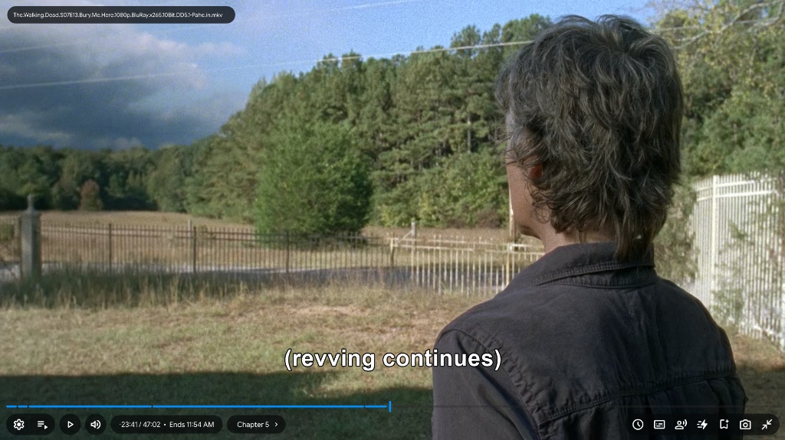
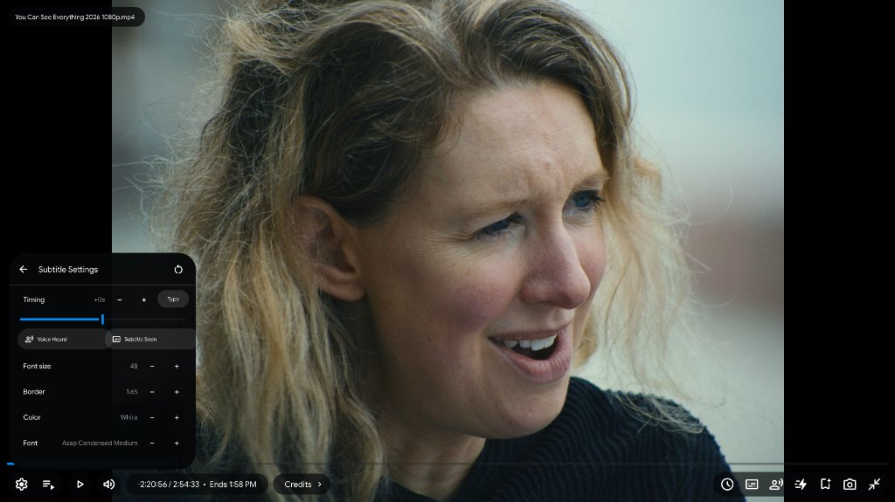
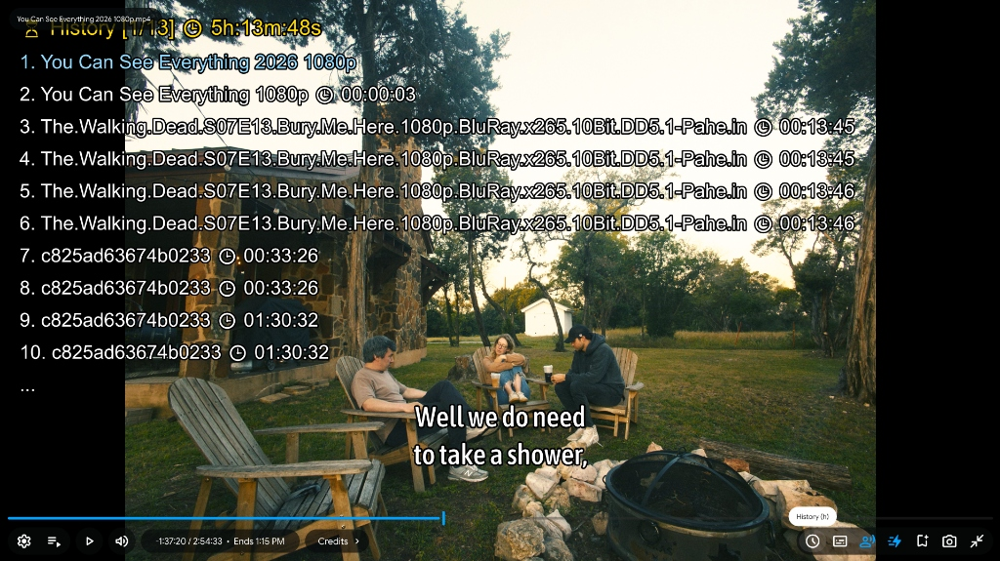

# MPV: Material OSC Revolution Edition (v3.1.1)

> **Release Notice (v3.1.1 · 3.x Series):** Smooth 144 Hz Windows playback (`gpu-api=d3d11`, `hwdec=auto-safe` / `d3d11va`, `video-sync=display-resample`, `tscale=oversample`) + zero-`vf` `notify_skip`, built on **Material OSC `0.0.15`** and the complete QoL script suite. See [update_log.txt](update_log.txt) for earlier v1→v2 history.

A heavily customized, GPU-accelerated setup for the [mpv media player](https://mpv.io/) on Windows (`vo=gpu`, `gpu-api=d3d11`, `hwdec=auto-safe`).

---

## 📦 Version History (`3.x`)

- **`v3.1.1` (Current):**
  - **Smooth 144 Hz Playback Fix:** Switched `gpu-api=d3d11` + `hwdec=auto-safe` (native `d3d11va` zero-copy decode) + `video-sync=display-resample` + `interpolation=yes` + `tscale=oversample` in [mpv.conf](mpv.conf), eliminating `winvk` 144 Hz swapchain jitter and output frame drops.
  - **Zero Video-Filter Overhead (`notify_skip`):** Removed background `vf` `blackdetect_notify` so hardware decoding stays zero-copy while chapter, audio silence, and subtitle music detection remain active.

- **`v3.1.0`:**
  - **Material OSC `0.0.15`:** Horizontal volume slider, updated `Material Symbols Rounded` + `Google Sans Flex` fonts, **Speed-only tooltip** (`Speed: 1.1x` without tooltip clutter on other buttons), **Shaders** & **Audio Mastering** Gear submenus.
  - **Smart File & Media Tools:**
    - `file-browser` (**`/`** or **Numpad `/`**) — browse drives and folders right inside mpv.
    - `locatefile.lua` (**`.`**) — reveal the currently playing file directly in Windows File Explorer (`ShellExecuteW`).
    - `trash_after_watch.lua` (**Numpad `.` / `Del`**) — toggle queueing the current video to move to the **Windows Recycle Bin** automatically when playback finishes (never permanent delete).
  - **Dynamic Intro / Outro Skip (`notify_skip`):**
    - `Tab`, `z`, `Z`, or clicking the **SKIP INTRO** / **SKIP ENDING** box dynamically skips openings, cold-open transitions, and end credits/title cards (7-minute intro/outro detection windows + subtitle music cues + black/silence detection).
  - **Fast Organized Screenshots + Clipboard (`mpvshot`):**
    - **`s` / `S`** saves fast `.jpg` screenshots (~200–500 KB) organized into `X:\Screenshots\TV\<Show>\` and `X:\Screenshots\Movies\<Movie (Year)>\` and copies the image directly to your Windows clipboard (Win32 `CF_DIB` — works dynamically on every press in **WhatsApp `Ctrl+V`** & **`Win+V`**).
    - **`Alt+s`** immediately opens Windows File Explorer with the **last captured screenshot** selected.
  - **Shaders & Config Fixes:**
    - Replaced broken `NVScaler.glsl` with real `v1.0.3` and added `NVSharpen.glsl` `v1.0.3`.
    - Added `smart_track_selector.lua` for automatic preferred audio/subtitle track selection.
    - Unblocked **`Alt+r`** (Remaster Toggle) from `SimpleHistory`, fixed `SimpleHistory.lua` nil-path crash, cleaned `thumbfast.conf` warnings, and removed duplicate `Ctrl+6` binding (`kp8` covers Mode C+A).
- **`v3.0.0`:** Initial Material OSC frontend migration, double-click edge seeking (`±5s`), switch-bounce guard, Subtitle Delay & Sync Suite, and clean YouTube/cookies support.

---

## 📸 Screenshots

### Main Material UI & Dynamic Finish Clock

### Thumbfast Thumbnail Preview

### Gear Settings Menu

### Subtitle Delay & Sync Suite (`Type` / Smooth Slider / `Voice Heard` & `Subtitle Seen`)

### Dedicated History Button (`SimpleHistory` Overlay)

### Anime4K Upscaling (`Mode C+A Fast`)

---

## ✨ Core Material OSC & Script Features

### 🎨 Custom Material OSC Interface
- **Top-Left Frosted Media Title Pill:** Displays the current video title cleanly at the top-left of the frame and fades smoothly with the controller.
- **Unobstructed Seekbar & Horizontal Volume:** Clean `#008cfb` accent seekbar with `Thumbfast` thumbnail previews, windowed mini progress bar, and horizontal volume slider (`volume_slider=horizontal`).
- **Dynamic Finish Clock (`Ends X:XX PM`):** Live speed-aware finish time shown alongside elapsed/remaining time, continuing to update even while paused.
- **Bottom-Left Utility Pill (`[Gear | Playlist]`):**
  - **Settings (`Gear`):** Single-click opens Video, Audio, Subtitles, Shaders, Audio Mastering, and Playback Speed controls anchored on the left.
  - **Playlist (`playlist_play` / `Alt+p`):** Opens the interactive Material folder & playlist drawer.
- **Bottom-Right Action Pill:**
  - **History (`history` / `h`):** Opens `SimpleHistory` directly from the player bar.
  - **Subtitles (`subtitles`):** Toggle/cycle tracks or open full subtitle management.
  - **Night Mode / Voice Boost (`graphic_eq` / `Alt+n`):** Toggles `dynaudnorm` vocal clarity compression (`@night_mode`).
  - **Remaster Vivid (`auto_awesome` / `Alt+r`):** Manual-only toggle (`target-peak=140`, `contrast=+4`, `saturation=+5`).
  - **Bookmark (`bookmark_add` / `B`):** One-click timeline bookmarking (`Bookmark N >` chapter chips).
  - **Speed (`speed`):** Click `+0.1x`, scroll `±0.05x`, right-click `1x` (shows clean `Speed: X.Xx` hover pill).
  - **Screenshot (`photo_camera` / `s`):** Fast `.jpg` capture to `X:\Screenshots` + instant clipboard copy.
  - **Fullscreen (`open_in_full`):** Toggle fullscreen without PiP clutter.
- **Clean Mouse Behavior:** Right-click toggles Play/Pause (`MBTN_RIGHT`), left double-click on center toggles Fullscreen, left double-click on left/right 15% edges seeks `±5s` (locked when panels are open), and single left-click play/pause is disabled.

---

## 💬 Built-In Subtitle Delay & Sync Suite
Inside **Gear (`Settings`) → Subtitles → Subtitle Settings**:
1. **Manual Exact Input (`Type` button):** Enter any delay in seconds (e.g. `-10`, `+4.5`, `0`) (`-300s` to `+300s`).
2. **Smooth Sync Slider:** Drag across `-30s` to `+30s` (plus `±0.1s` step buttons).
3. **Two-Tap Audio/Subtitle Sync:** Tap **Voice Heard** when dialogue starts and **Subtitle Seen** when text appears to calculate and apply the exact offset automatically.
4. **Persistent Per-File Memory:** Adjusted `sub-delay` is saved automatically per file (`material-osc-sub-sync.json`) and restored on reopen.

---

## ⌨️ Complete Keybindings Reference

### Files, Screenshots & Navigation (New & Updated)
| Key | Action |
| :--- | :--- |
| **`/`** *(or Numpad `/`)* | Open / toggle **File Browser** (`file-browser`) |
| **`.`** *(main Full Stop)* | **Reveal in File Explorer** (`locatefile.lua` — highlights current video) |
| **`Numpad .` / `Del`** (`KP_DEC` / `KP_DEL`) | Toggle **Recycle Bin After Watch Finishes** (`trash_after_watch.lua` — never permanent delete) |
| **`s`** / **`S`** | Take organized `.jpg` **Screenshot** (with / without subs) + **auto-copy to clipboard** (`Ctrl+V` / `Win+V`) |
| **`Alt + s`** | **Reveal Last Screenshot** in Windows File Explorer (`mpvshot`) |
| **`Tab`** / **`z`** / **`Z`** *(or click button)* | **Skip Intro / Opening / Ending** (`notify_skip`) |

### Playback, UI & Tools
| Key | Action |
| :--- | :--- |
| **`Right Click`** | Play / Pause (`MBTN_RIGHT`; single left-click play/pause disabled) |
| **`Left Double-Click`** | **Center:** Toggle Fullscreen · **Left / Right 15% Edges:** Seek **`-5s` / `+5s`** (locked in menus/panels) |
| **`h` / `H`** | Open **SimpleHistory** list |
| **`Ctrl + y`** | Load and resume last played item |
| **`Ctrl + Alt + r`** | Load last played item without resuming |
| **`Ctrl + H`** | Toggle **SimpleHistory** incognito mode |
| **`Alt + p`** | Toggle Material OSC **Playlist** drawer |
| **`Ctrl + ,`** | Toggle Material OSC **Settings** (`Gear`) menu |
| **`B` / `b`** | Add timeline **Bookmark** |
| **`Alt + n`** | Toggle **Night Mode / Voice Boost** (`dynaudnorm`) |
| **`Alt + r`** | Toggle **Remaster Vivid** (`target-peak=140`, contrast `+4`, saturation `+5`) |
| **`k`** | Mark Start / End cut point (`mpv-easy-cut`) |
| **`g`** / **`Alt + g`** | Export Lossless Clip (`-c copy` → `X:/Screen Clips`) / Export GIF (`mpv-easy-cut`) |
| **`Alt + BS`** | Cancel current `mpv-easy-cut` selection |

### Subtitles, Framing & Color
| Key | Action |
| :--- | :--- |
| **`c` / `x`** | Shift subtitle delay **`-0.05s` / `+0.05s`** |
| **`Alt + v`** | Instant **Voice-to-Subtitle Sync** |
| **`Ctrl + s`** | Shrink & raise subtitles (`sub-pos -10`, `sub-scale -0.31111`) |
| **`o`** | Set aspect ratio **`1.43:1`** (IMAX) |
| **`Alt + x` / `Alt + c`** | Zoom out & pan frame / Reset video zoom & pan |
| **`Ctrl + 1` / `Ctrl + 0`** | **Color Boost** (`brightness 3, saturation 5, gamma -1`) / Reset all color values to `0` |
| **`kp1` / `kp2` / `kp3`** | HDR reset (`spline`, peak `180`) / Cycle `target-peak` (`130–203`) / Cycle `tone-mapping` |
| **`kp4` / `kp5` / `kp6`** | Set speed **`1.5x`** / **`1.0x`** / **`1.25x`** |

### GLSL Shaders (`Numpad` & `Ctrl`)
| Key | Shader Preset |
| :--- | :--- |
| **`kp8`** | **Anime4K: Mode C+A (Fast)** |
| **`kp9`** | **Anime4K: Mode A+A (Fast)** |
| **`Ctrl + 2`** | **FSRCNNX x2 (`8-0-4-1`)** Movie Upscaler |
| **`Ctrl + 3`** | **KrigBilateral + SSimSuperRes + FSRCNNX x2** (Max Quality) |
| **`j`** | **FilmGrain-Light + NVScaler (`v1.0.3`)** |
| **`Alt + f`** | **FilmGrain Only** |
| **`kp7`** | Clear all active GLSL shaders |

---

## ⚙️ Installation (Windows)
1. Install a recent **mpv** Windows build with Vulkan/FFmpeg support into its **own** folder (e.g., `C:\Users\<Username>\mpv-player\`) — **do not** place `mpv.exe` inside `%AppData%\mpv`, or mpv will load every script twice.
2. Clone this repository (or extract the `v3.1.0` release zip) into `%AppData%\mpv` (`C:\Users\<Username>\AppData\Roaming\mpv`).
3. Place `ffmpeg.exe` in your `mpv` folder (or on `PATH`) for `mpv-easy-cut` exports, and update `screenshot-directory` in [mpv.conf](mpv.conf), `screenshot_root` in [mpvshot.conf](script-opts/mpvshot.conf), and `output-directory` in [mpv-easy-cut.conf](script-opts/mpv-easy-cut.conf) if needed.

