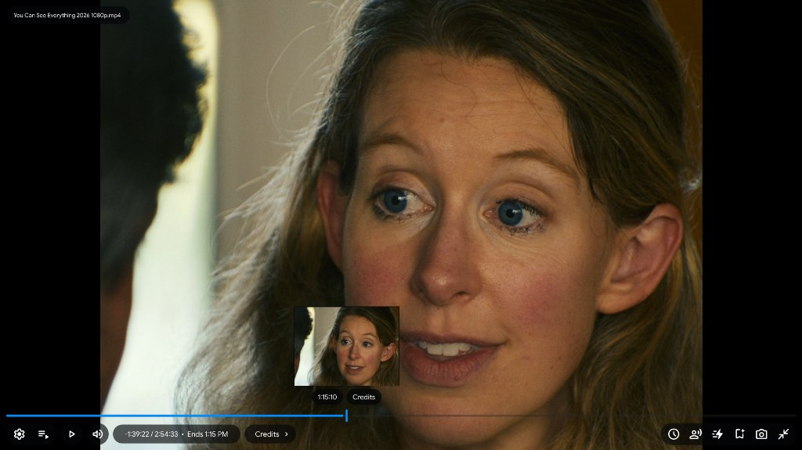
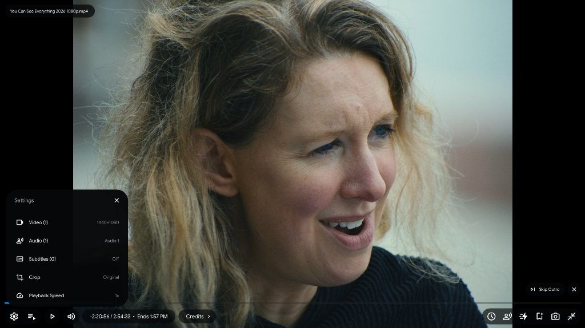
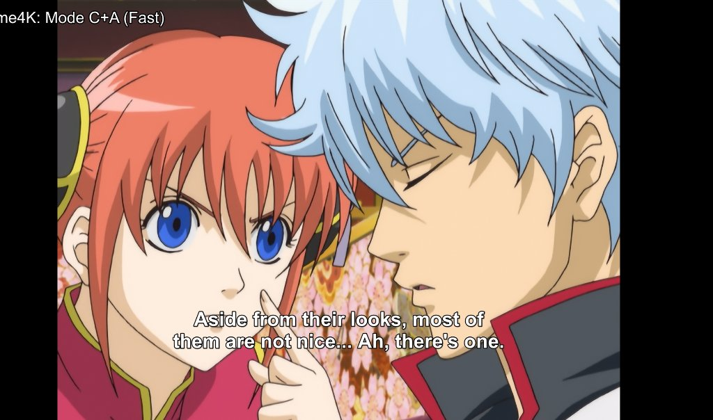

# MPV: Material OSC Revolution Edition (v2.0)

> **Evolution Notice (v2.0):** This repository evolved from the **UOSC × Modern Z** build into a custom-engineered **Material OSC** frontend — preserving all shaders, `SimpleHistory` auto-resume, `Thumbfast` previews, and hotkeys while upgrading every control into a responsive Material Design 3 interface. See [update_log.txt](update_log.txt) for the full commit-by-commit changelog from v1 to v2.

A heavily customized, GPU-accelerated setup for the [mpv media player](https://mpv.io/) on Windows (`vo=gpu`, `gpu-api=vulkan`, `hwdec=nvdec`).

---

## 📸 Screenshots

### Main Material UI & Dynamic Finish Clock

### Thumbfast Thumbnail Preview

### Gear Settings Menu

### Subtitle Delay & Sync Suite (`Type` / Smooth Slider / `Voice Heard` & `Subtitle Seen`)

### Dedicated History Button (`SimpleHistory` Overlay)

### Anime4K Upscaling (`Mode C+A Fast`)

---

## ✨ What's New in v2.0

### 🎨 Custom Material OSC Interface
- **Top-Left Frosted Media Title Pill:** Displays the current video title cleanly at the top-left of the frame and fades smoothly with the controller.
- **Unobstructed Seekbar & Windowed Mini-Bar:** Clean `#008cfb` accent seekbar with `Thumbfast` thumbnail previews; mini bottom progress bar appears only when windowed and hides in fullscreen.
- **Dynamic Finish Clock (`Ends X:XX PM`):** Live speed-aware finish time shown alongside elapsed/remaining time, continuing to update even while paused.
- **Bottom-Left Utility Pill (`[Gear | Playlist]`):**
  - **Settings (`Gear`):** Single-click opens Video, Audio, Subtitles, and Playback Speed controls anchored cleanly on the left.
  - **Playlist (`playlist_play` / `Alt+p`):** Opens the interactive Material folder & playlist drawer (add files, add links, reorder, or drag).
- **Bottom-Right Action Pill:**
  - **History (`schedule` / `h`):** Opens `SimpleHistory` directly from the player bar.
  - **Subtitles (`subtitles`):** Toggle/cycle tracks or open full subtitle management.
  - **Night Mode / Voice Boost (`record_voice_over` / `Alt+n`):** Toggles `dynaudnorm` vocal clarity compression (`@night_mode`).
  - **Remaster Vivid (`bolt_boost` / `Alt+r`):** Manual-only toggle (`target-peak=140`, `contrast=+4`, `saturation=+5`) — stays off until enabled.
  - **Bookmark (`bookmark_add` / `B`):** One-click timeline bookmarking (`Bookmark N >` chapter chips).
  - **Screenshot (`photo_camera` / `s`):** Captures with subtitles to `X:/Screenshots` (`mpv-%f-%n`) and prints the saved path via `osd-msg`.
  - **Fullscreen (`fullscreen`):** Toggle fullscreen without PiP clutter.
- **Clean Mouse Behavior:** Right-click toggles Play/Pause (`MBTN_RIGHT cycle pause`), left-click play/pause and `±5s` accidental edge-seek overlays disabled.

---

## 💬 Built-In Subtitle Delay & Sync Suite
Inside **Gear (`Settings`) → Subtitles → Subtitle Settings (`subtitles_gear`)**:
1. **Manual Exact Input (`Type` button):** Enter any delay in seconds (e.g. `-10`, `+4.5`, `0`) via an always-on-top dialog (`-300s` to `+300s`).
2. **Smooth Sync Slider:** Drag seamlessly across `-30s` to `+30s` (plus `±0.1s` step buttons).
3. **Two-Tap Audio/Subtitle Sync:** Tap **Voice Heard** when dialogue starts and **Subtitle Seen** when text appears (in either order) to calculate and apply the exact offset automatically.
4. **Persistent Per-File Memory:** Any adjusted `sub-delay` is saved automatically per file (`material-osc-sub-sync.json`) and restored the next time you open that video.

---

## 🧰 Scripts, History & Shaders
- **Resilient `SimpleHistory` Auto-Resume:** Automatically resumes your last watched video on launch, skips missing/unsupported entries safely, and blacklists synthetic `av://` / `lavfi:` streams.
- **Lightweight `skip-intro.lua` (`Tab` / `z`):** Chapter-aware Skip Intro overlay with minimal overhead.
- **Shaders (`Ctrl+1` / `Ctrl+2` / `Ctrl+3` / `j`):** Anime4K, FSRCNNX / KrigBilateral / SSimSuperRes, NVScaler + FilmGrain-Light.
- **`playlistmanager.lua`, `SmartCopyPaste.lua`, `trackselect.lua`, `webm.lua`, `thumbfast.lua`.**

---

## ⚙️ Installation (Windows)
1. Install a recent **mpv** Windows build with Vulkan/FFmpeg support.
2. Clone this repository into `%AppData%\mpv` (`C:\Users\<Username>\AppData\Roaming\mpv`).
3. Update `screenshot-directory` in [mpv.conf](mpv.conf) if you don't use `X:/Screenshots`.
